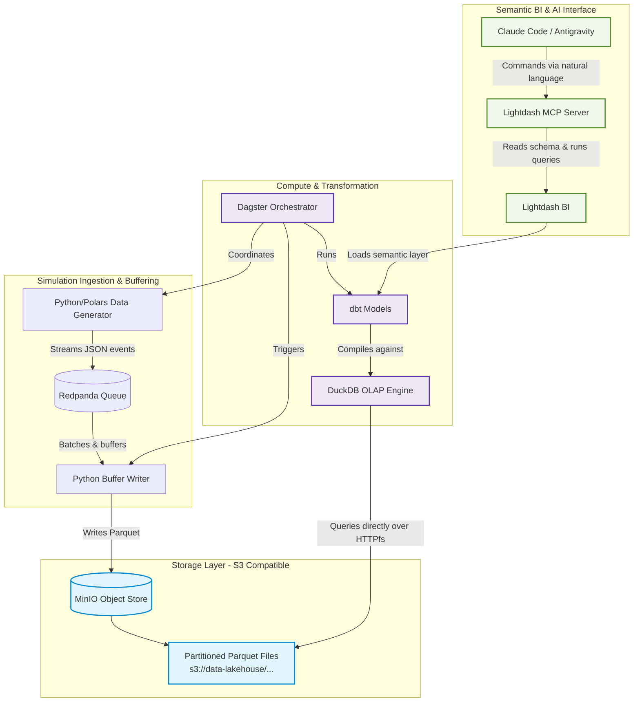

# Project Sandbox: Decoupled Storage & Compute Data Stack

Project Sandbox is a local-first, production-grade data engineering stack designed to simulate and aggregate high-volume enterprise workloads. 

The architecture decouples the storage layer from the compute layer by leveraging an S3-compatible object store (**MinIO**) as a data lakehouse. It processes partitioned Parquet data via **DuckDB** and runs modular transformations via **dbt**, orchestrated by **Dagster**. The transformed metrics are exposed to AI workflows using **Lightdash** and a custom **Model Context Protocol (MCP)** server.

---

## 🏗️ Architectural Overview



---

## 🛠️ Technology Stack

* **Infrastructure:** [k3s](https://k3s.io/) (Lightweight Kubernetes) managed locally via [k3d](https://k3d.io/) in Docker.
* **Ingestion Queue:** [Redpanda](https://redpanda.com/) single-broker development cluster for transaction buffering.
* **Storage Layer:** S3-compatible [MinIO](https://min.io/) storing partitioned Apache Parquet files.
* **Compute Engine:** [DuckDB](https://duckdb.org/) using the `httpfs` extension to scan Parquet files.
* **Transformation & Orchestration:** [dbt-core](https://www.getdbt.com/) and [Dagster](https://dagster.io/).
* **Semantic BI & AI Layer:** [Lightdash](https://www.lightdash.com/) and a custom Model Context Protocol (MCP) server.

---

### MCP Server (AI Semantic Layer)

The custom MCP server (`src/mcp_server.py`) exposes the dbt semantic layer to LLMs via the Model Context Protocol. It uses `fastmcp` and operates in two modes:

- **Primary (DuckDB direct):** Reads `semantic_manifest.json` and queries `dev.duckdb` directly. Always works without infrastructure.
- **Optional (Lightdash API):** When `LIGHTDASH_URL` and `LIGHTDASH_TOKEN` are set, additional tools interact with the Lightdash REST API.

#### Usage

```bash
make mcp          # stdio transport (for LLM integration)
make mcp-http     # HTTP transport at http://localhost:8079
make test-mcp     # run integration tests
```

#### Available MCP Tools

| Tool | Source | Description |
| :--- | :--- | :--- |
| `list_metrics` | Manifest | List all 8 dbt semantic metrics |
| `list_semantic_models` | Manifest | List all 4 semantic models with entities, dimensions, measures |
| `get_metric_details` | Manifest | Deep dive on one metric (measure, agg, dimensions) |
| `list_available_dimensions` | Manifest | Dimensions/entities valid for grouping a metric |
| `query_metric` | DuckDB | Execute a bounded metric query (group_by, date range, limit) |
| `generate_chart` | DuckDB + matplotlib | Generate dark-themed PNG chart, save to disk |
| `lightdash_status` | Lightdash API | Check if Lightdash is reachable (optional) |
| `lightdash_list_charts` | Lightdash API | List saved charts in Lightdash (optional) |
| `lightdash_get_catalog` | Lightdash API | Get data catalog from Lightdash (optional) |

#### LLM Client Configuration

For **Claude Code** or **opencode**, add to `.mcp.json`:

```json
{
  "mcpServers": {
    "project-sandbox": {
      "type": "stdio",
      "command": "uv",
      "args": ["run", "python", "src/mcp_server.py"],
      "cwd": "/path/to/de-for-fun"
    }
  }
}
```

#### Optional Lightdash Configuration

```bash
export LIGHTDASH_URL="http://localhost:8080"
export LIGHTDASH_TOKEN="ldt_your_personal_access_token"
export LIGHTDASH_PROJECT_UUID="your-project-uuid"
```

#### Community Alternatives

- [`lightdash-mcp`](https://pypi.org/project/lightdash-mcp/) — Python MCP server (PyPI) by poddubnyoleg, 30+ tools for full CRUD
- [`lightdash-mcp-server`](https://www.npmjs.com/package/lightdash-mcp-server) — TypeScript MCP server (npm) by syucream, 10 read-only tools
- Lightdash built-in `/api/v1/mcp` — Enterprise feature, requires `MCP_ENABLED=true` + license key

---

## 🚀 Quick Start

### 1. Prerequisites
Ensure you have `docker` installed and running on your host machine.

### 2. Dependency Setup
Install the cluster dependencies (`k3d` and `kubectl`):
```bash
make setup
```

### 3. Bootstrap Cluster
Spin up the containerized local Kubernetes cluster:
```bash
make up
```

### 4. Deploy Services
Deploy MinIO, PostgreSQL, Redpanda, Redpanda Console, Dagster, and Lightdash to the cluster:
```bash
make deploy
```

### 5. Check Cluster Status
Verify all pods are running and services are exposed:
```bash
make status
```

* **Dagster UI:** [http://localhost:3000](http://localhost:3000)
* **Lightdash UI:** [http://localhost:8080](http://localhost:8080)
* **MinIO Console:** [http://localhost:9001](http://localhost:9001) (Credentials: `minioadmin` / `minioadmin`)
* **Redpanda Console:** [http://localhost:8083](http://localhost:8083)

### 6. Generate Synthetic Data & Buffer to MinIO

Generate synthetic data and stream it to Redpanda:
```bash
make generate              # 100K rows (default)
make generate ROWS=500000  # Custom row count
make generate-full         # 50M+ rows (full scale)
```

Start the buffer writer to consume from Redpanda and write partitioned Parquet files to MinIO (run in a separate terminal):
```bash
make buffer
```

Verify data in MinIO Console at [http://localhost:9001](http://localhost:9001) — look for `data-lakehouse/{domain}/{table}/year=YYYY/month=MM/` partitioned Parquet files.

### 7. Mount Compute & Query Data

Mount DuckDB views over the Parquet files in MinIO (requires data to have been buffered):
```bash
make mount              # Create DuckDB views via httpfs over MinIO Parquet
make query              # Run analytical aggregation queries (fan density, sales velocity, sentiment)
make verify             # Validate row counts, schema integrity, and partition columns
```

The DuckDB database is persisted at `data/compute.duckdb` and can be reused by dbt and other tools.

### 8. Run dbt Transformations & Semantic Layer

dbt models build staging views and aggregate marts on top of the MinIO Parquet files via DuckDB:
```bash
make dbt-parse             # Parse and validate dbt model syntax
make dbt-compile           # Compile dbt models to SQL
make dbt-run               # Build tables/views in DuckDB (requires MinIO data)
make dbt-test              # Run dbt data quality tests
```

The dbt project includes 13 models (4 base, 4 staging, 4 marts, 1 time spine), 4 semantic models, and 8 metrics for the AI semantic layer.

### 9. Orchestrate with Dagster

Start the Dagster UI to run and monitor the full pipeline (generator -> buffer -> verify -> dbt):
```bash
make orchestrate           # Start Dagster UI at http://localhost:3000
```

The Dagster instance exposes 20 assets: synthetic data generation, buffer writing, data verification, and all dbt models auto-discovered from the manifest.

### 10. Clean Up
Tear down the cluster and delete container configurations cleanly:
```bash
make down
```

---

## 📁 Repository Structure

```text
├── docs/                 # Product requirements and task checklists
├── k3s/                  # Kubernetes manifests (MinIO, Postgres, Dagster, Lightdash)
├── scripts/              # Infrastructure orchestration scripts
├── src/
│   ├── config.py              # Shared config (Redpanda, MinIO, schemas, topics)
│   ├── generator_seg.py       # SEG data generator (fan_pings, pos_transactions)
│   ├── generator_podium.py    # Podium data generator (interaction_events, ai_telemetry)
│   ├── generator.py           # Combined generator orchestrator
│   ├── buffer_writer.py       # Redpanda consumer → MinIO Parquet writer
│   ├── mount_duckdb.py        # DuckDB view registration over MinIO Parquet
│   ├── query_duckdb.py        # Analytical query suite on Parquet views
│   ├── verify_data.py         # Parquet row count and schema validation
│   ├── bootstrap_storage.py   # MinIO bucket setup
│   └── orchestration/         # Dagster asset definitions (generator → dbt pipeline)
├── dbt_project/          # dbt models (base, staging, marts), semantic layer, and metrics
├── Makefile              # Project shortcuts
└── pyproject.toml        # Python dependencies managed by uv
```
