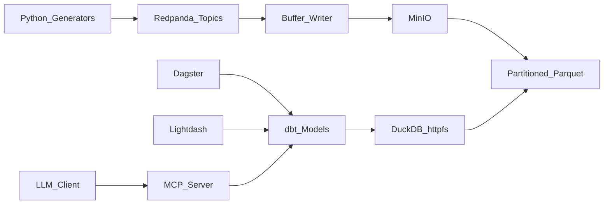
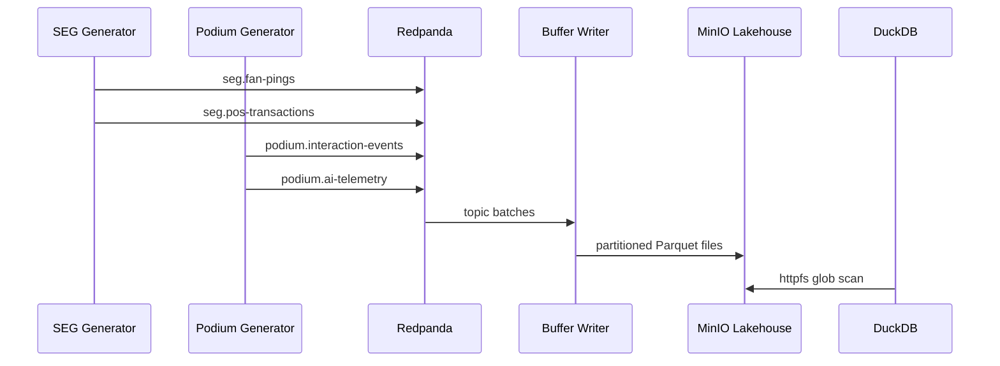
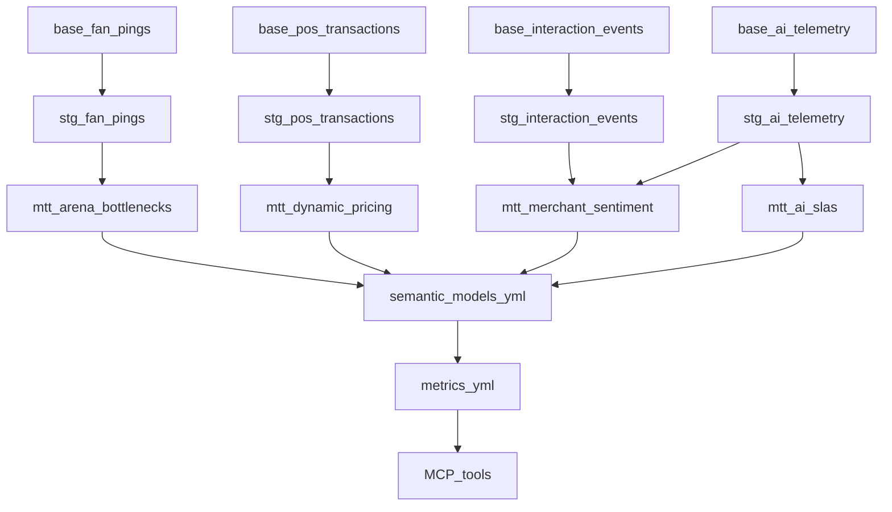
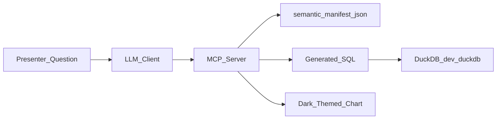

<div class="kicker">Meetup Demo Deck</div>

# <span class="hero-title">A <span class="gradient">cloud-shaped data platform</span> that runs on your laptop</span>

<p class="hero-subtitle">
Project Sandbox simulates enterprise data engineering end-to-end: streaming ingestion, object storage, DuckDB compute, dbt models, Dagster orchestration, Lightdash BI, and MCP-powered AI access.
</p>

<div class="stat-grid mt-10">
  <div class="stat"><div class="value">4</div><div class="label">source event streams</div></div>
  <div class="stat"><div class="value">13</div><div class="label">dbt models</div></div>
  <div class="stat"><div class="value">8</div><div class="label">semantic metrics</div></div>
  <div class="stat"><div class="value">100%</div><div class="label">local demo path</div></div>
</div>

---

<div class="kicker">The Pitch</div>

## Why This Repo Exists

<div class="deck-grid mt-8">
  <div class="glass-card primary">
    <h3>Realistic data stack</h3>
    <p>Redpanda, MinIO, DuckDB, dbt, Dagster, Lightdash, and MCP are wired together in one reproducible local sandbox.</p>
  </div>
  <div class="glass-card secondary">
    <h3>No cloud account required</h3>
    <p>k3d gives us a local Kubernetes-shaped environment while keeping the demo portable for a meetup room.</p>
  </div>
  <div class="glass-card">
    <h3>AI-ready semantic layer</h3>
    <p>The custom MCP server exposes dbt semantic metrics to LLM clients without forcing the model to invent SQL.</p>
  </div>
  <div class="glass-card">
    <h3>Live-demo friendly</h3>
    <p>Every major phase is a Makefile command: bring up infra, generate events, buffer Parquet, build models, query metrics.</p>
  </div>
</div>

---

<div class="kicker">Architecture</div>

## The System Map



---

<div class="kicker">Repository Tour</div>

## What To Point At In The Editor

<div class="deck-grid three mt-6">
  <ArchitectureCard tag="config" title="src/config.py" detail="Topics, schemas, tenant domains, MinIO, Redpanda, MCP, and streaming config live in one shared Python module." />
  <ArchitectureCard tag="ingest" title="src/generator*.py" detail="Synthetic SEG and Podium workload generators stream JSON events into Redpanda topics." />
  <ArchitectureCard tag="lake" title="src/buffer_writer.py" detail="Consumes Redpanda, batches by topic, and writes partitioned Parquet into MinIO." />
  <ArchitectureCard tag="compute" title="src/mount_duckdb.py" detail="Registers DuckDB views over MinIO Parquet using httpfs and hive-style partitions." />
  <ArchitectureCard tag="models" title="dbt_project/models" detail="Base views, staging views, incremental marts, semantic models, metrics, and time spine." />
  <ArchitectureCard tag="ai" title="src/mcp_server.py" detail="FastMCP server turns semantic metrics into tool calls and chart generation." />
</div>

---

<div class="kicker">Live Demo 1</div>

## Bring Up The Local Platform

<DemoStep title="Start the k3d-backed stack" outcome="This creates the local Kubernetes cluster and deploys MinIO, Redpanda, Dagster, Lightdash, Postgres, and service wiring." risk="If Docker or k3d is not ready, skip to screenshots or show the manifests in k3s/.">
  <div class="deck-grid mt-5">
    <CopyCommand label="One-time setup" command="make setup" />
    <CopyCommand label="Cluster + services" command="make up
make deploy
make status" />
  </div>
</DemoStep>

<p class="mt-5">URLs to open once healthy: <strong>Dagster :3000</strong>, <strong>Lightdash :8080</strong>, <strong>MinIO :9001</strong>, <strong>Redpanda Console :8083</strong>.</p>

---

<div class="kicker">Data Flow</div>

## Four Event Streams Become Lakehouse Tables



---

<div class="kicker">Live Demo 2</div>

## Generate And Buffer Data

<div class="deck-grid mt-6">
  <DemoStep title="Terminal 1: producer" outcome="Generate synthetic arena and merchant events into Redpanda." risk="Use a smaller ROWS value if the room Wi-Fi or Docker host is struggling.">
    <CopyCommand label="Producer" command="make generate ROWS=100000" />
  </DemoStep>
  <DemoStep title="Terminal 2: consumer" outcome="Consume Redpanda topics and flush partitioned Parquet into MinIO." risk="If this blocks waiting for data, show Redpanda Console and explain idle flushing.">
    <CopyCommand label="Consumer" command="make buffer" />
  </DemoStep>
</div>

<div class="warning-note mt-5">Pipeline order matters: generate -> buffer -> mount -> dbt-run -> MCP. Skipping ahead is a good way to demonstrate why orchestration exists.</div>

---

<div class="kicker">Storage</div>

## Object Storage As The Data Lakehouse

<div class="deck-grid mt-8">
  <div class="glass-card primary">
    <h3>Partition shape</h3>
    <p><code>{domain}/{table}/tenant_id={tenant}/year=YYYY/month=MM/{batch_id}.parquet</code></p>
  </div>
  <div class="glass-card secondary">
    <h3>Why it matters</h3>
    <p>DuckDB can scan Parquet directly through MinIO's S3-compatible API. Compute stays decoupled from storage.</p>
  </div>
</div>

<CopyCommand class="mt-7" label="Open MinIO" command="open http://localhost:9001" note="Credentials: minioadmin / minioadmin" />

---

<div class="kicker">Live Demo 3</div>

## Mount, Query, Verify

<DemoStep title="Turn Parquet into queryable views" outcome="DuckDB registers views over MinIO Parquet, runs analytical queries, and validates row counts/schema shape." risk="If MinIO data is empty, explain that buffer must flush before DuckDB can see files.">
  <div class="deck-grid mt-5">
    <CopyCommand label="Mount views" command="make mount" />
    <CopyCommand label="Query + verify" command="make query
make verify" />
  </div>
</DemoStep>

---

<div class="kicker">dbt Layer</div>

## From Raw Events To Business Marts



---

<div class="kicker">Incremental Models</div>

## The Marts Are Built For Streaming Demos

<div class="deck-grid mt-7">
  <div class="glass-card primary">
    <h3>mtt_arena_bottlenecks</h3>
    <p>Groups fan pings by tenant, zone, beacon, hour, and day. Calculates dwell time, high-dwell counts, bottleneck ratio, and congestion level.</p>
  </div>
  <div class="glass-card secondary">
    <h3>mtt_ai_slas</h3>
    <p>Aggregates AI telemetry into token consumption, p50/p95/p99 latency, SLA counts, and compliance rate.</p>
  </div>
</div>

```sql
where timestamp >= (
  select coalesce(max(latest_timestamp), '1970-01-01'::timestamp)
  from {{ this }}
)
```

---

<div class="kicker">Semantic Layer</div>

## Metrics The Audience Can Understand

<div class="deck-grid three mt-5">
  <MetricCard name="total_revenue" model="dynamic_pricing" description="Total POS revenue across tenants, vendors, items, and time." />
  <MetricCard name="sales_velocity" model="dynamic_pricing" description="Derived metric: total revenue divided by transaction count." accent="secondary" />
  <MetricCard name="arena_bottleneck_ratio" model="arena_bottlenecks" description="High-dwell pings as a proportion of total arena pings." accent="accent" />
  <MetricCard name="average_dwell_time" model="arena_bottlenecks" description="Average dwell time by arena zone, beacon, hour, or tenant." />
  <MetricCard name="merchant_sentiment_score" model="merchant_sentiment" description="Average sentiment across merchant/customer interactions." accent="secondary" />
  <MetricCard name="ai_sla_compliance" model="ai_slas" description="Rate of AI telemetry events that met the SLA threshold." accent="warning" />
</div>

---

<div class="kicker">Live Demo 4</div>

## Compile dbt And Test The MCP Server

<DemoStep title="Expose dbt semantics to AI tools" outcome="dbt creates semantic_manifest.json, then the MCP test suite exercises metric discovery, query generation, and chart tooling." risk="If semantic_manifest.json is stale, rerun compile and restart the MCP server.">
  <div class="deck-grid mt-5">
    <CopyCommand label="Compile semantic manifest" command="make dbt-compile" />
    <CopyCommand label="Run MCP test" command="make test-mcp" />
  </div>
</DemoStep>

---

<div class="kicker">AI Interface</div>

## MCP Turns Metrics Into Tools



<CopyCommand class="mt-4" label="HTTP MCP" command="make mcp-http" note="Starts the HTTP transport at http://localhost:8079" />

---

<div class="kicker">Live Demo 5</div>

## Continuous Streaming Mode

<div class="deck-grid mt-6">
  <DemoStep title="Deploy continuous generators" outcome="Generator pods produce wall-clock events while the buffer writer flushes Parquet every 15 minutes." risk="If you do not want to wait for flushes live, show pod logs and explain the schedule.">
    <CopyCommand label="Start stream" command="make stream" />
  </DemoStep>
  <DemoStep title="Watch the pipeline" outcome="Dagster rebuilds dbt incrementally on a 30-minute schedule while DuckDB glob views discover new Parquet files." risk="Use local mode if Kubernetes is not cooperating.">
    <CopyCommand label="Observe" command="make orchestrate
kubectl logs -f deployment/generator-seg
kubectl logs -f deployment/buffer-writer" />
  </DemoStep>
</div>

---

<div class="kicker">Demo Safety</div>

## The Sharp Edges Are Useful Teaching Moments

<div class="deck-grid mt-7">
  <div class="glass-card">
    <h3>Docker must be running</h3>
    <p>k3d is Kubernetes in Docker. If Docker is down, the platform is down.</p>
  </div>
  <div class="glass-card">
    <h3>The order is real</h3>
    <p>dbt cannot build useful marts until Redpanda data is buffered into MinIO and DuckDB views are mounted.</p>
  </div>
  <div class="glass-card">
    <h3>MCP loads manifest at startup</h3>
    <p>After changing dbt models or metrics, recompile dbt and restart the MCP server.</p>
  </div>
  <div class="glass-card">
    <h3>MetricFlow is intentionally absent</h3>
    <p>The MCP server queries DuckDB directly from the dbt semantic manifest.</p>
  </div>
</div>

---

<div class="kicker">Fallback Path</div>

## If Live Infra Misbehaves

<div class="deck-grid mt-6">
  <CopyCommand label="Local continuous mode" command="make generate-continuous
make buffer-continuous
make orchestrate" />
  <CopyCommand label="No-infra semantic path" command="make dbt-compile
make test-mcp" note="Works if semantic_manifest.json and dev.duckdb exist." />
</div>

<p class="mt-8">Fallback story: walk the audience through code, dbt models, semantic metrics, and MCP tool behavior even if the local Kubernetes stack is not healthy.</p>

---

<div class="kicker">Theme Controls</div>

## Reskin The Deck From One File

<div class="deck-grid mt-7">
  <div class="glass-card primary">
    <h3>One control plane</h3>
    <p>Change <code>slides/styles/theme.css</code> to adjust background, foreground, primary, secondary, accent, surfaces, borders, shadows, radii, code colors, and diagram colors.</p>
  </div>
  <div class="glass-card secondary">
    <h3>Mermaid follows tokens</h3>
    <p><code>MermaidDiagram.vue</code> reads CSS variables at render time, so edges and node colors update with the rest of the deck.</p>
  </div>
</div>

```css
:root {
  --deck-bg: #070a12;
  --deck-fg: #e8f0ff;
  --primary: #00d4ff;
  --secondary: #a855f7;
  --diagram-edge: #7dd3fc;
}
```

---

<div class="kicker">Close</div>

# Ship The Demo

<p class="hero-subtitle">The repo is a complete local-first data platform: event generation, streaming buffer, object storage, DuckDB compute, dbt semantics, orchestration, BI, and MCP access for AI workflows.</p>

<div class="deck-grid mt-8">
  <CopyCommand label="Start deck" command="make slides" />
  <CopyCommand label="Stop stream after demo" command="make stream-stop
make down" />
</div>

<p class="mt-8"><strong>Tagline:</strong> a practical data engineering playground you can run, inspect, break, and explain from a single laptop.</p>
